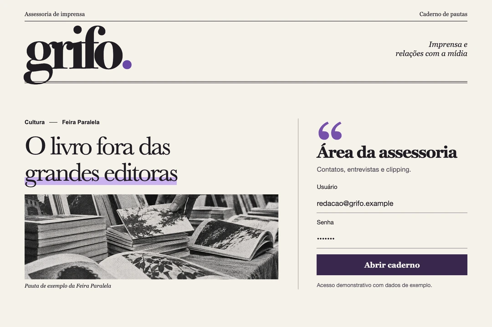

# Grifo

A jornalista Lia Avelar quer conversar com uma editora antes da abertura da Feira Paralela. Se outra pessoa da assessoria assumir essa pauta amanhã, ela vai precisar saber o que a Lia pediu, com quem combinou a entrevista e quando prometemos dar retorno.

Foi desse ponto que parti para desenvolver o Grifo. É um caderno de assessoria de imprensa que reúne cada jornalista, as conversas sobre a pauta e as matérias que saíram. Também dá para reservar uma exclusiva com um veículo e consultar até quando ela vale.

**[Abrir o caderno de pautas](https://cv.mauromota.com/demos/imprensa.html)**

## Pegue a pauta de onde ela parou

Abra **O livro fora das grandes editoras**, da Feira Paralela, e selecione **Lia Avelar**, do Caderno Aberto. O histórico mostra o pedido de entrevista com a editora Olívia Nery. Em **Registrar conversa**, anote o que ficou combinado e escolha o próximo retorno. Ao abrir a ficha de novo, você encontra a nova conversa junto das anteriores.

## O detalhe da agenda

Uma assessoria pode cuidar de várias pautas ao mesmo tempo. Ao agendar uma entrevista, fiz a verificação considerar o horário de início, a duração e os compromissos do jornalista e do porta-voz em todas as pautas. Se houver sobreposição, o aviso identifica onde já existe um compromisso.

A organização das pautas e exclusivas está em um arquivo. Os registros de conversas, entrevistas e clipping estão em outro. [Pautas e contatos](js/imprensa.js) · [Histórico e agenda](js/imprensa-registros.js)

## Rodar no seu computador

Abra `index.html` na pasta baixada e clique em **Abrir caderno**. Os campos de acesso já vêm preenchidos. Desenvolvi este front-end em HTML, CSS e JavaScript. Os contatos e as pautas são fictícios, o login é simulado e os registros ficam neste navegador.
